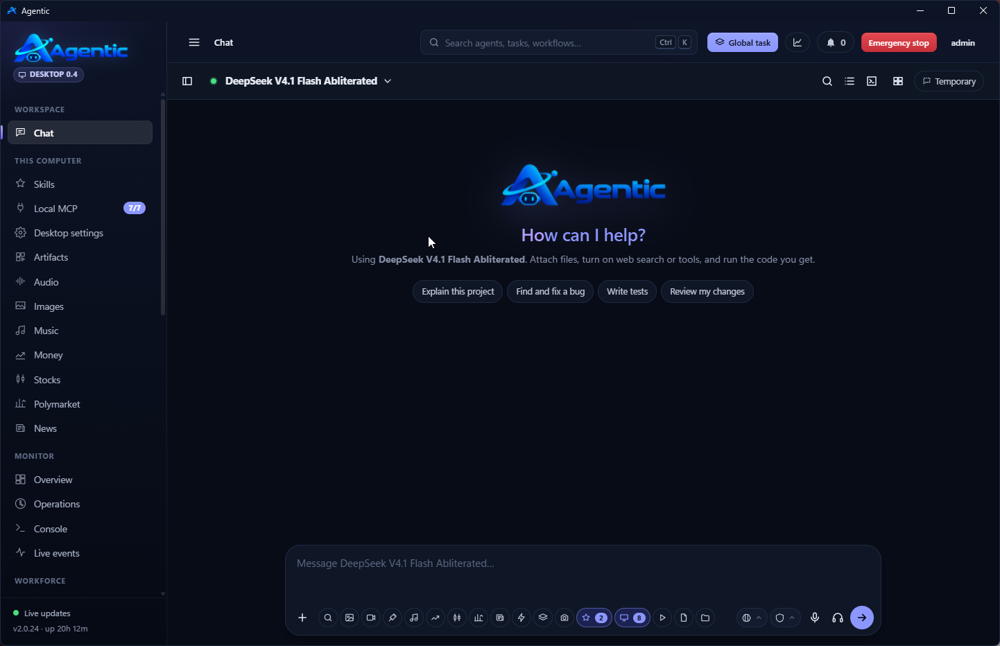
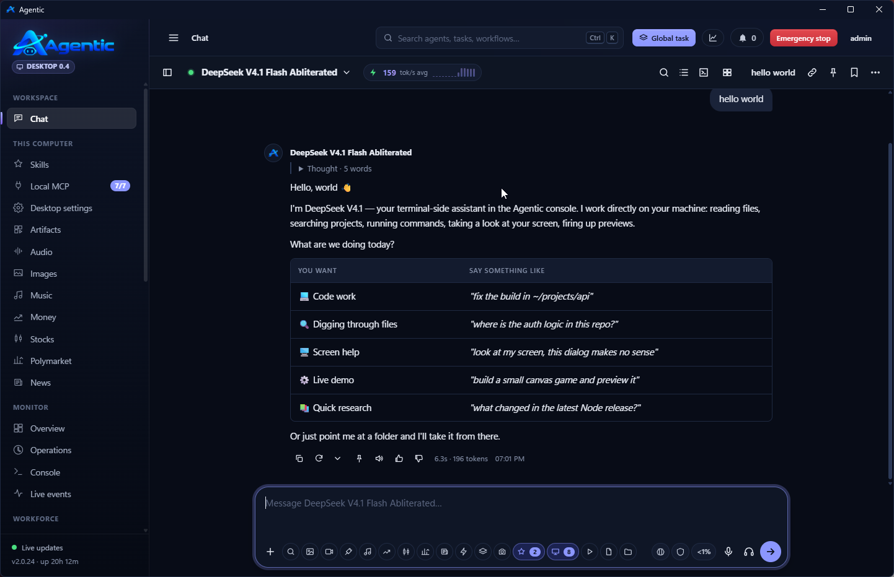
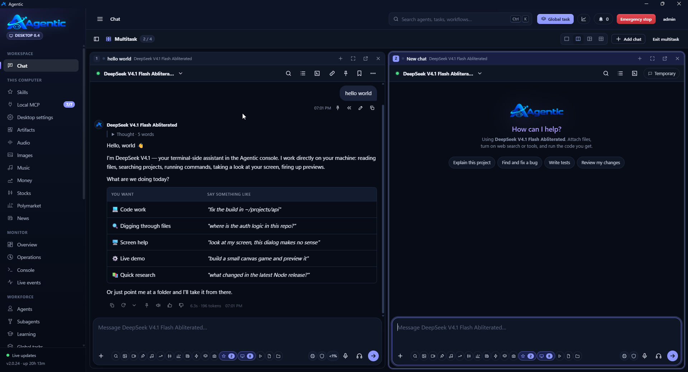

<div align="center">


**Agentic Desktop: your Agentic server in a desktop app, with tools that work on your own computer.**

[](https://github.com/smurflabs/Agentic_desktop/releases)
[](LICENSE)


[Install](#install) · [Screenshots](#screenshots) · [Features](#features) · [Setup guide](SETUP.md) · [Reference manual](docs/REFERENCE.md) · [Agentic server](https://github.com/smurflabs/Agentic)

</div>

---

## What is it?

Agentic Desktop shows your [Agentic server](https://github.com/smurflabs/Agentic)'s web app in a window of its own and opens on **Chat**. You get the same pages, look and permissions as in the browser, always in step with the server's version.

It also adds what only a desktop app can do: the model can work with the files, commands, Claude Code skills and MCP servers on your computer, and every change waits for your approval.

```text
WebView2 window ──► local server on 127.0.0.1
                      ├─ desktop layer and local tools (files, commands, skills, MCP)
                      └─ everything else ──► your Agentic server (your API key is added here, never in the page)
```

## Screenshots

<table>
  <tr>
    <td width="50%" valign="top">
      <br>
      <sub><b>The whole web app</b> in its own window, plus <b>This computer</b>: Skills, local MCP servers and Desktop settings.</sub>
    </td>
    <td width="50%" valign="top">
      <br>
      <sub><b>Chat</b>: skills and this computer's tools are chips in the message box, and the model bar shows live speed.</sub>
    </td>
  </tr>
  <tr>
    <td colspan="2" valign="top">
      <br>
      <sub><b>Multitask</b>: up to four chats side by side, each answering live.</sub>
    </td>
  </tr>
</table>

## Features

### Tools on this computer

- **Files and commands:**
  - read, search, write and edit files in the workspace folders you choose
  - run PowerShell or cmd commands (bash on Linux)
  - call the Agentic API as you
- **Approvals:** changes wait for you, following the chat's permission mode. You can answer **Allow once**, **Always allow in this chat** or **Deny** in any open window.
- **Use from other windows:** while the app is open, chats started in the web app can use this computer's tools too.
- **Parallel agents:** the model splits independent work into subagents that run at the same time.
- **Monitors:** the model can watch a log, a dev server or a build, and react to new output.

### Skills and MCP

- **Claude Code skills and slash commands** from `~/.claude`, from Claude Code plugins and from the app's own library. You can create, edit, import and use them in chat.
- **Local MCP servers** over stdio, Streamable HTTP or SSE. You can import them from Claude Code, Claude Desktop, VS Code and Visual Studio, browse and test their tools, and set them to *Ask first*.

### Run, preview and share

- **Run and test projects** from the **Run** chip:
  - `.agentic/launch.json` or `.claude/launch.json`
  - otherwise detected from the project: npm scripts, static sites, Django, Flask, FastAPI, pytest, .NET, Go, Rust, Makefiles
- **Preview pane:** a web app opens beside the chat, with developer tools. Tests show their exit code and an **Ask Agentic to fix it** button.
- **Artifacts:** projects and chat pages can be shared as public links.

### A real desktop app

- **Global shortcuts:** **Ctrl+Alt+Space** opens a new chat from any app, and **Ctrl+Alt+S** takes a screenshot of part of the screen into the chat.
- **Notification-area icon** and Windows notifications when an answer finishes or a chat needs you.
- **Voice:** dictation, Dictation mode and answers read aloud with the server's voices.
- **Every tab of the web app,** including Audio, Images and Music.
- **Self-updating:** the app and its desktop layer update themselves from your Agentic server.
- **Look:** the title bar follows the web app's light or dark theme.

## Install

### From a release

Download the build for your system from [Releases](https://github.com/smurflabs/Agentic_desktop/releases):

| File | System |
|---|---|
| `AgenticDesktop-<version>-x64.msi` | **Windows installer.** Installs for your account only, with no administrator rights, and adds Start menu and desktop shortcuts. |
| `AgenticClient.exe` | Windows, portable: one self-contained file. Run it from any folder you can write to. |
| `agentic-desktop-<version>-linux-x64.tar.gz` | Linux x64 |
| `agentic-desktop-<version>-linux-arm64.tar.gz` | Linux ARM64 |
| `agentic-desktop-<version>-osx-arm64.tar.gz` | macOS on Apple silicon (M1 and later) |
| `agentic-desktop-<version>-osx-x64.tar.gz` | macOS on Intel |

On Windows you need Windows 10 (version 2004) or later, x64, with the [WebView2 Runtime](https://developer.microsoft.com/microsoft-edge/webview2/), which Windows 11 already has. On Linux and macOS, extract the archive and run `./Agentic-Desktop/AgenticClient`. The window opens in Chrome, Chromium, Edge, Brave or Vivaldi.

### From your Agentic server

When your server's administrator has published the desktop app, download it from **Apps & updates** in the web app.

### From source

```powershell
dotnet publish -o publish                         # Windows
dotnet publish -r linux-x64 -o publish-linux      # Linux
```

This needs the [.NET 10 SDK](https://dotnet.microsoft.com/download/dotnet/10.0). Keep the `www` folder next to the program.

## Connect

1. In the Agentic web app, open the user menu, then **API key** → **Generate**.
2. Start the app and switch on **Use a different server**.
3. Type your server's address, then paste the key.

On Windows the key is stored encrypted for your account (DPAPI). On Linux it is stored in `~/.config/AgenticClient/key`, which only you can read.

## Documentation

- **[SETUP.md](SETUP.md):** requirements, installing, connecting, settings files and troubleshooting.
- **[docs/REFERENCE.md](docs/REFERENCE.md):** the complete manual, covering chat tools, Run and preview, skills, local MCP servers, shortcuts, Linux, updates and security.

## Building

```powershell
dotnet build
```

The app is written in VB.NET on .NET 10. On Windows it uses WinForms and WebView2. On Linux it builds for plain `net10.0` and opens a browser app window, with the same local server behind it.

## License

Agentic Desktop is free software: you can redistribute it and/or modify it under the terms of the [GNU General Public License](LICENSE) as published by the Free Software Foundation, either version 3 of the License, or (at your option) any later version.
